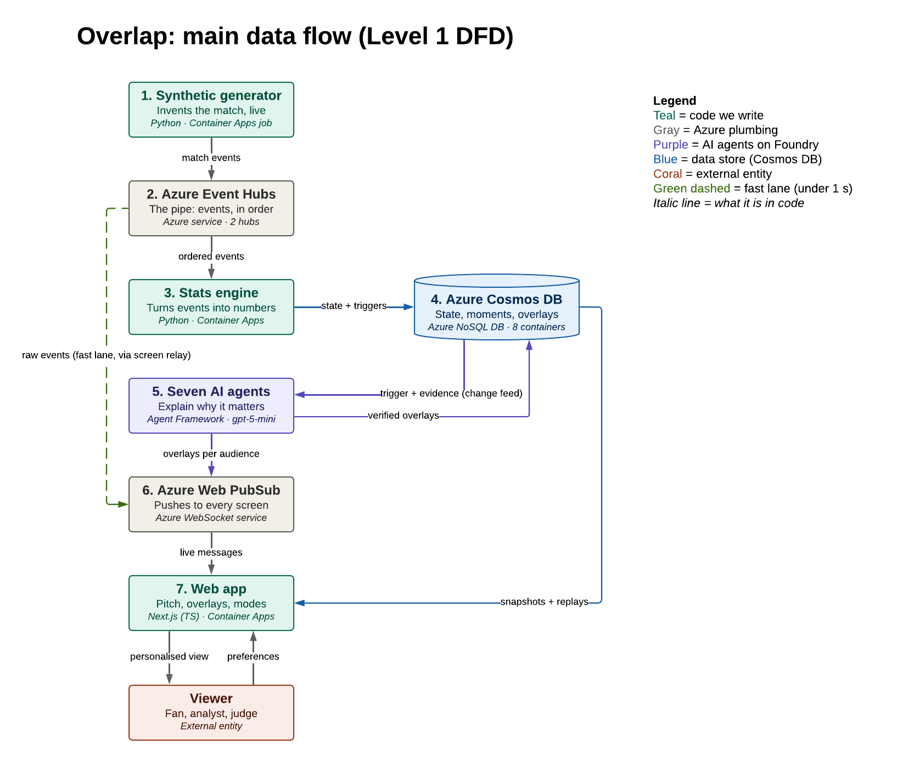
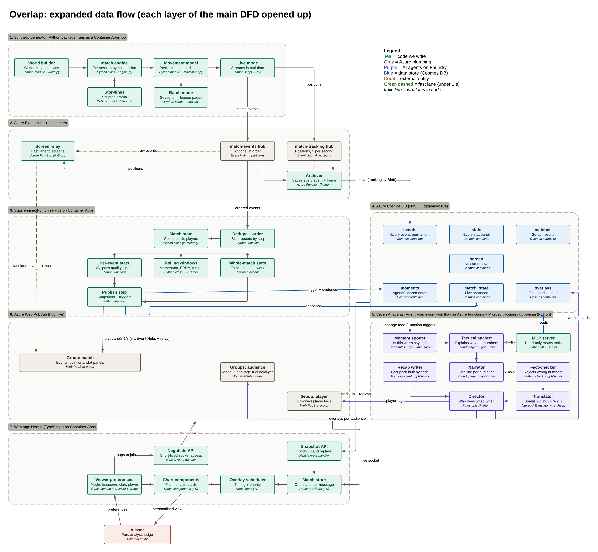

# Overlap

[](https://github.com/ARNAV2684/Overlap/actions/workflows/main.yml)

**Every fan watches a different match.**

Overlap is a live football match companion where seven agents on Microsoft Foundry explain each big moment as it
happens, check every number before it reaches the screen, and write it for the person watching: a casual fan, an
analyst, a club's supporter, a follower of one player, in English, Spanish, Hindi or French.

- **Live link:** https://ca-overlap-web.agreeablestone-46edcfef.swedencentral.azurecontainerapps.io
  (the Azure pipeline is paused between test windows: replays play and the start button is hidden)
- **Video:** coming
- **Judge's guide:** [`docs/testing.md`](docs/testing.md)

## What it does

A synthetic match engine plays a full football match and streams every event and every player's position (5 times a
second) into Azure. A stats engine turns the stream into numbers (xG, pass difficulty, pressing, momentum, distance,
sprints) and flags the moments worth explaining. For each moment, a Microsoft Agent Framework workflow of seven
agents reads the context through our own MCP server, writes a line for every audience, checks every number in code
and every claim with a second model call, translates, and sends one card per audience through Azure Web PubSub.

On screen: a 3D pitch drawn from the tracking data, story overlays, the live commentary strip, live insight cards
(head-to-head, connections, engine room, tempo), charts, a full-time recap, and league, club and player pages.

Numbers come from code, words come from the agents. An agent may only cite numbers from the moment's evidence pack,
and a card is labelled **AI · checked** only when a model wrote it and the fact-checker passed it; otherwise it is a
**Stat line · checked** template.

## The five stages

| # | Stage | What happens | Runs on |
|---|---|---|---|
| 1 | **Generate** | A synthetic league; each match played possession by possession: events plus tracking at 5 Hz | Container Apps job ([`generator/`](generator)) |
| 2 | **Stream** | Events and tracking enter Event Hubs; the relay forwards them to browsers, the archiver keeps every match for replay | Event Hubs, Functions ([`functions/`](functions), [`archiver/`](archiver)), Cosmos DB, Blob Storage |
| 3 | **Measure** | Per-event metrics, rolling windows, stat panels, and moment triggers with evidence packs | Container Apps ([`stats/`](stats)) |
| 4 | **Explain** | Seven agents per moment, with context over MCP, fact-checked and translated | Functions, Foundry gpt-5-mini, Translator ([`agents/`](agents), [`mcp_server/`](mcp_server)) |
| 5 | **Deliver** | One ordered stream of checked cards per audience; the Next.js screen | Web PubSub, Container Apps ([`web/`](web)) |

## Architecture

**Deployed on Azure** (resource group `rg-overlap`, Sweden Central):


**Main data flow** (the seven layers):



**Each layer opened up** (the generator, Event Hubs and its readers, the stats engine, Cosmos DB containers, the
seven agents and MCP, Web PubSub groups, the web app):



Two lanes: the **fast lane** (stages 1, 2, 5) puts every event and position on screen within about a second; the
**slow lane** (stages 3, 4) adds the explained cards a few seconds later. Every service signs in with a managed
identity; there are no keys. Details: [`docs/architecture.md`](docs/architecture.md).

## Microsoft stack

| Technology | What it does in Overlap | Where |
|---|---|---|
| Microsoft Foundry, gpt-5-mini | Writes, judges and ranks lines; the recap. Every agent run traced; published lines scored with Azure AI Evaluation; Content Safety ready | [`agents/models.py`](agents/models.py), [`agents/telemetry.py`](agents/telemetry.py), [`agents/evals/foundry_quality.py`](agents/evals/foundry_quality.py), [`infra/modules/foundry.bicep`](infra/modules/foundry.bicep) |
| Microsoft Agent Framework | The seven-stage workflow, the chat client, the MCP client | [`agents/workflow.py`](agents/workflow.py), [`agents/context.py`](agents/context.py) |
| Model Context Protocol | Our read-only match tools for the analyst | [`mcp_server/`](mcp_server), [`agents/embedded_context.py`](agents/embedded_context.py) |
| Azure AI Translator | Spanish, Hindi and French, names kept | [`agents/translation.py`](agents/translation.py) |
| Azure Event Hubs | The match stream, three consumer groups | [`infra/modules/event-hubs.bicep`](infra/modules/event-hubs.bicep) |
| Azure Functions | Relay; archiver, moment trigger, agents, publisher | [`functions/function_app.py`](functions/function_app.py), [`infra/modules/functions.bicep`](infra/modules/functions.bicep) |
| Azure Container Apps | Web app, stats engine, generator job | [`infra/modules/container-apps.bicep`](infra/modules/container-apps.bicep) |
| Azure Cosmos DB | Archive, moments, agent job state, overlays | [`infra/modules/cosmos.bicep`](infra/modules/cosmos.bicep) |
| Azure Web PubSub | Live frames and per-audience cards to browsers | [`infra/modules/web-pubsub.bicep`](infra/modules/web-pubsub.bicep) |
| Azure Blob Storage | Archived tracking, checkpoints, Functions host | [`infra/modules/storage.bicep`](infra/modules/storage.bicep) |
| Application Insights | Logs for every app, and one trace per card: each agent, model call and MCP call | [`infra/modules/monitoring.bicep`](infra/modules/monitoring.bicep), [`agents/specs/observability.md`](agents/specs/observability.md) |
| Bicep + `azd` | The whole resource group as code | [`infra/main.bicep`](infra/main.bicep), [`azure.yaml`](azure.yaml) |
| GitHub, GitHub Actions, GitHub Copilot | Repository, pull requests, 11 CI jobs on every PR, Copilot in the editor and in reviews | [`.github/workflows/`](.github/workflows) |

More, with the reasons for each choice: [`docs/microsoft-stack.md`](docs/microsoft-stack.md).

## The seven agents

| Agent | Job |
|---|---|
| **Spotter** | Code rules rank and merge moments (goals first) and share out the model budget; a small model call ranks the normal ones |
| **Analyst** | Reads the moment's context through the MCP server (live state, pressing, pass network, player context, period comparison) and writes an interpretation without numbers |
| **Narrator** | Writes the English line for casual, analyst, each club and each followed player |
| **Fact-checker** | Checks every number in code, then the meaning with a separate model call; failures go back for at most two rewrites, then the line's template |
| **Translator** | Spanish, Hindi and French with Azure AI Translator, names kept; every translated line re-checked |
| **Director** | Rules only: picks the chart, times the card, builds one overlay per audience |
| **Recap writer** | At full time, the story of the match from a fact pack built by code |

One job per moment, saved stage by stage in Cosmos `moments`, so a crashed run resumes and a duplicate never runs
twice. Any model failure falls back to the checked template for that step only. Details:
[`agents/README.md`](agents/README.md).

## Personalisation

- **Modes:** Casual, Analyst, My club, Player focus.
- **Languages:** English, Español, हिन्दी, Français.
- **Club** and **followed player**: each combination reads its own Web PubSub group, so two viewers of the same
  match see different cards at the same moment.
- **Moment types:** goal, red card, penalty, milestone, shot cluster, big chance, momentum swing, press change,
  head-to-head, connection, workhorse.

## Results

On Azure (24 Oct, full 20× matches SYN-3000 to SYN-3008, everything in Sweden Central):

- 9 of 9 matches archived identical to their recordings.
- Every reader 0 s behind Event Hubs at p50, 1 s at p95, 3 s at worst; 3,009 function runs, 0 failed.
- A full match plays in 6 min 40 s.

Agents bench ([`agents/evals/results/round-1/report.md`](agents/evals/results/round-1/report.md)):

- 24 matches, 538 moments, 100% recall on every independently labelled trigger.
- 0 wrong numbers in 12,236 published lines; fault injection catches every numeric fault, with 0 valid lines rejected.

Line quality on Azure (Azure AI Evaluation on the Foundry deployment, 60 lines of SYN-3010): groundedness 98.3%,
relevance 91.7%, fluency 100% ([`docs/evaluation.md`](docs/evaluation.md#line-quality-azure-ai-evaluation)).

Single agent against the seven, on gpt-5-mini (same 17 moments): the narrator alone published 65 of 109 lines that no
check could tie to the evidence; the seven agents published none, rewrote 69 and replaced the rest with checked stat
lines ([`docs/evaluation.md`](docs/evaluation.md#single-vs-multi-agent-w3)).

Known gap: at 20× a card is live for only 15 real seconds, and on Azure most cards are still checked templates
(**Stat line · checked**). Across four matches on 25 Oct the model-written share was 5–16%; each run removed one cause
(a slow MCP start, one job at a time, a strict numeric check, a breaker that paused the model) and the next fix is in
review. Every run is in [`docs/evaluation.md`](docs/evaluation.md#live-ai-share-on-azure-25-oct).

## Run locally

Needs Docker Desktop, Python 3.12 with [uv](https://docs.astral.sh/uv/), Node 22. Full run order:
[`infra/specs/local-development.md`](infra/specs/local-development.md) §5.

```bash
cd infra/local && ACCEPT_EULA=Y docker compose up -d     # Event Hubs, Cosmos DB and Azurite emulators
cd infra/local/webpubsub_standin && uv run standin       # local Web PubSub stand-in
cd functions && uv run python relay_runner.py            # screen relay (or func start in functions/dist)
cd archiver && uv run python main.py                     # archiver
cd stats && uv run python main.py live                   # stats engine
cd agents && uv run python ../functions/moment_trigger.py   # agents and publisher (templates unless a model is set)
cd web && cp .env.example .env.local && npm install && npm run dev   # http://localhost:3000
cd generator && uv run python cli.py live --hubs emulator --speed 20 --first-match 1   # play a match
```

Model settings are in [`infra/local/env.example`](infra/local/env.example): provider `off` (templates), `local`
(Foundry Local) or `azure`. Each component README has its own commands.

## Deploy

Bicep with `azd`, one resource group, managed identity everywhere: [`infra/README.md`](infra/README.md) (deploy, run a
match, pause and resume). Costs and budgets: [`infra/specs/costs.md`](infra/specs/costs.md).

## Tests and CI

| Suite | Tests passing on `main`, 26 Oct (opt-in tests skipped) |
|---|---|
| Agents | 281 |
| MCP server | 150 (3 skipped) |
| Stats engine | 76 (1 skipped) |
| Functions | 20 |
| Web app | 612 (4 skipped) |
| Generator | 112 (2 skipped) |
| Archiver | 5 (2 skipped, need the storage emulators) |

1,256 tests pass in all.

Python suites run with `uv run pytest` in each folder; the web app with `npx vitest run`. GitHub Actions runs 11 jobs
on every pull request: ruff and pytest for each changed Python project, web lint, type check and build, Bicep build and lint, a secrets scan, and policy and scope checks ([`.github/workflows/`](.github/workflows)).
After every merge, [`main.yml`](.github/workflows/main.yml) runs everything on the whole of `main` (every Python
project's tests, ruff, the web tests and build, the Bicep template); the badge above shows its result.

## Repository

| Path | What lives there |
|---|---|
| [`generator`](generator) | Synthetic match generator: world, match engine, movement, storylines |
| [`stats`](stats) | Stats engine: metrics, rolling windows, moment triggers, evidence packs |
| [`archiver`](archiver) | Stores every event and tracking chunk for replays |
| [`agents`](agents) | The seven agents, the workflow, the evaluation bench |
| [`mcp_server`](mcp_server) | MCP server exposing match context as read-only tools |
| [`functions`](functions) | Azure Functions: relay, archiver, moment trigger, recap trigger, publisher |
| [`web`](web) | Next.js web app |
| [`infra`](infra) | Bicep for `azd`, container images, the local stack |
| [`fixtures`](fixtures), [`data/recorded`](data/recorded) | Synthetic examples and recorded matches |
| [`docs`](docs) | Architecture, Microsoft stack, evaluation, judge's guide, demo script, responsible AI |

[`CONTRACTS.md`](CONTRACTS.md) holds the message shapes every layer builds against; [`CALIBRATION.md`](CALIBRATION.md)
every generator target with its public source; [`CONTRIBUTING.md`](CONTRIBUTING.md) how we work.

## Data

All match data is **synthetic**: clubs, players, leagues and matches are invented by our generator. No real clubs,
players, leagues or logos, and no personal data. Calibration targets come from public aggregate statistics, cited in
[`CALIBRATION.md`](CALIBRATION.md). See [`docs/responsible-ai.md`](docs/responsible-ai.md).

## Team

Arnav Gupta, Azeem, Pranav and Vedant.

## Licence

[MIT](LICENSE)
