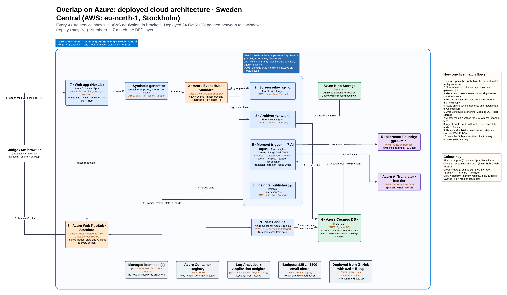

# Architecture (as deployed)

Overlap runs in one Azure resource group, `rg-overlap`, in Sweden Central, deployed from Bicep with `azd`
([`infra/README.md`](../infra/README.md)). This page describes what ran on Azure on 24 Oct 2026 and what is paused
now. Message shapes are in [`CONTRACTS.md`](../CONTRACTS.md); component notes with evidence are in
[`knowledge/README.md`](knowledge/README.md).

The same flow as data flow diagrams: [main](img/main-dfd.png) and [each layer opened up](img/expanded-dfd.png).

## The three flows

### Live flow (the fast lane)

1. The **generator** (Container Apps job, started by the web app's **Start a live match** button) plays a synthetic
   match and sends every event to Event Hubs `match-events` and every tracking frame (all players and the ball, 5 Hz)
   to `match-tracking`, both partitioned by match.
2. The **screen relay** (Functions app `live`, consumer group `relay`) reads both hubs, keeps the match's screen state
   in Cosmos `screen`, and forwards positions, events, status and stat panels to Web PubSub hub `live`, in `seq`
   order per match. Positions and stats go out 8 at a time; events and status stay strictly in order.
3. The **web app** (Next.js on Container Apps) asks `/api/negotiate` for a receive-only Web PubSub URL and draws the
   3D pitch, score, timeline and charts from the stream. A late joiner gets a snapshot first.

### Archive flow

1. The **archiver** (Functions app `insights`, consumer group `archiver`) writes every match to Cosmos (`matches`,
   `events`, `stats`) and the tracking frames to Blob Storage (`tracking`).
2. Replays read the archive through `/api/replay/<id>` and play at 1×, 5× or 20× with play and pause. When nothing is
   live, the home page plays the newest finished match.
3. `archiver/tests/check_archive.py <match>` compares an archive with the generator's recording; on Azure, 9 of 9
   matches were identical, one even with both Functions apps restarted mid-match.

### Insight flow (the slow lane)

1. The **stats engine** (Container Apps, 1 replica, consumer group `stats`) computes every metric, puts its stat panels
   back on `match-events` (`kind=stats`) for the relay and archiver, keeps `match_state`, and writes each flagged
   moment with its evidence pack to Cosmos `moments`.
2. The Cosmos change feed starts **`moment_trigger`** (Functions app `insights`), which validates the moment and
   claims `job:<moment_id>` once, with a lease.
3. The seven agents run as one Agent Framework workflow: spotter → analyst (MCP tools) → narrator → fact-checker →
   translator → director. Each stage saves its output on the job; the director's result goes to
   `outbox:<moment_id>`. At full time **`recap_trigger`** runs the recap writer.
4. **`insights_publisher`** (timer, every second) checks each outbox against the playhead, reserves the audience
   group's next `seq` with the delivery document in one Cosmos transaction (`overlays`), sends the card to that
   group in Web PubSub and marks it sent. A card that is too late expires instead of showing.

## Two Functions apps, one plan

Both apps run from one zip on one B3 plan (4 cores, 1 instance):

- **`live`** runs the screen relay alone. When the relay shared a Python worker with the archiver and agents, it fell
  80–120 s behind at 20×; on its own app it stays 0–3 s behind.
- **`insights`** runs the archiver, the moment trigger, the recap trigger and the publisher. They share one event loop
  and one set of dependencies, so the model breaker and budgets are shared across jobs.

Batches of 300 messages and 16 worker threads keep up with a 20× match (about 113 tracking frames a second).

## Observability

- **Every app** sends logs and requests to Application Insights and Log Analytics (0.5 GB daily cap).
- **Every card** has one trace from the agents: the job, a span per agent, each model call and each MCP tool call,
  with the match, moment and agent on every span and no line text. On Azure the traces of SYN-3010 matched the jobs'
  records in Cosmos exactly ([`agents/specs/observability.md`](../agents/specs/observability.md)).
- **Every job** also keeps its own record in Cosmos `moments`: each stage's output, model calls, durations and
  fact-check rounds, so a card can be explained after the match.
- **Line quality** is scored with Azure AI Evaluation on the Foundry deployment ([`evaluation.md`](evaluation.md)).

## Latency

| Measure | Result | Where |
|---|---|---|
| Every Event Hubs reader behind the stream (SYN-3008, 20×, Azure) | 0 s p50, 1 s p95, 3 s worst | A8, [`PLAN_infra_azure-pass`](../plans/active/PLAN_infra_azure-pass.md) handover |
| Function runs (SYN-3008) | 3,009, 0 failed | same |
| Full match at 20× | 6 min 40 s | same |
| Moment written → card sent, template cards (local live runs) | 1 s p50, 3 s p95 | [`round-1 report`](../agents/evals/results/round-1/report.md) |
| Moment written → card sent, model cards (local small model) | 10 s p50, 13 s p95 | [`live-SYN-0702`](../agents/evals/results/live-SYN-0702/report.md) |
| Cards expired (SYN-3003, Azure, 24 Oct) | 45 of 566 (8%) | A8 handover |
| Moment written → card sent, model cards (SYN-3010, Azure, 25 Oct) | 16 s p50, 24 s p95 | [`live-SYN-3010`](../agents/evals/results/live-SYN-3010/report.md) |
| Deliveries expired (SYN-3010, Azure) | 206, against 167 sent | same |

At 20× a card is live for 15 real seconds. On Azure on 24 Oct a fresh MCP process per job (4–5 s) plus the narrator's
single structured call (3–11 s on gpt-5-mini) rarely fitted, so most cards were checked templates. On 25 Oct four
matches each removed one more cause (in-process MCP sessions, two jobs per match at once, a fact-checker lenient on
precision) and the model-written share was 5–16%; a late model line still expires and its template takes its place.
The runs are in [`evaluation.md`](evaluation.md#live-ai-share-on-azure-25-oct).

## Security

- **Managed identity everywhere.** Four user-assigned identities (functions, stats, generator, web), each with only
  its roles: the web app reads Cosmos and the tracking blobs and may start the generator job (a custom role that can
  only start the job and read its executions); the generator sends to Event Hubs; the agents call the model and Translator. Local auth (keys) is off on Event Hubs, Cosmos DB and Web PubSub; Storage has shared keys
  off. No Key Vault, because there are no secrets ([`infra/specs/security.md`](../infra/specs/security.md)).
- **One public entry point:** the web app, HTTPS only. Functions have no HTTP triggers; the stats engine and generator
  have no ingress.
- **Browsers only receive.** `/api/negotiate` issues a receive-only Web PubSub URL, valid 10 minutes, for at most 4
  groups of one match.
- **Starting a match is limited:** one match at a time across the site, 3 starts per visitor and 6 in total per hour,
  cross-site requests refused, and the button hidden while the pipeline is paused.
- **No personal data:** no accounts; viewer preferences stay in the browser.

## Scaling

Sized for up to 3 matches at once at 20×:

- Event Hubs Standard, 1 throughput unit, 4 partitions per hub; one consumer group per reader, each with its own
  checkpoints, so relay, archiver and stats scale and recover independently.
- Cosmos DB: every container partitioned by `match_id`; 4,000 RU/s shared during live runs (1,000 RU/s throttled a
  20× match), back to the free 1,000 between runs.
- Web PubSub Standard S1 during runs; one group per audience, so a card is sent once per audience, not once per viewer.
- Functions B3, 1 instance; the stats engine runs one replica; Container Apps scale the web app (to zero while
  paused).
- The agents run only on flagged moments (about 75 a match), never on every event, with a cap on model jobs per
  match.

## Cost

From [`infra/specs/costs.md`](../infra/specs/costs.md):

- While everything runs: about $5.5–8 a day (Web PubSub, Container Apps and Event Hubs are the main drivers), plus
  Cosmos above the free tier while at 4,000 RU/s (about $0.24 an hour).
- Model: a $25 hard cap, enforced by the agents' per-match budgets, the deployment's tokens-per-minute limit and a
  budget alert at 50, 80 and 100 %. About 75K model tokens a match.
- 24 Oct, the full Azure day (nine matches): about $3 estimated from list prices.
- Paused: the registry (about $0.17 a day) and cents of storage and logs.
- Subscription budgets alert at every $25 step up to $200.

## Pause and resume

**Paused now** (since the 25 Oct runs): Event Hubs, the Functions plan and both apps, the stats engine, the generator job and
the model deployment are deleted; Web PubSub is on Free, Cosmos DB on its free 1,000 RU/s, and the web app scales to
zero. The public link still serves the home page and every replay; the start button is hidden.

**Resume:** set five `azd` values back (`LIVE_PIPELINE=true`, `WEB_MIN_REPLICAS=1`, `DEPLOY_MODEL=true`,
`WEBPUBSUB_SKU=Standard_S1`, `COSMOS_THROUGHPUT=4000`), run `azd provision`, and deploy the Functions zip. Commands:
[`infra/README.md`](../infra/README.md#pause-after-a-run-and-resume).
